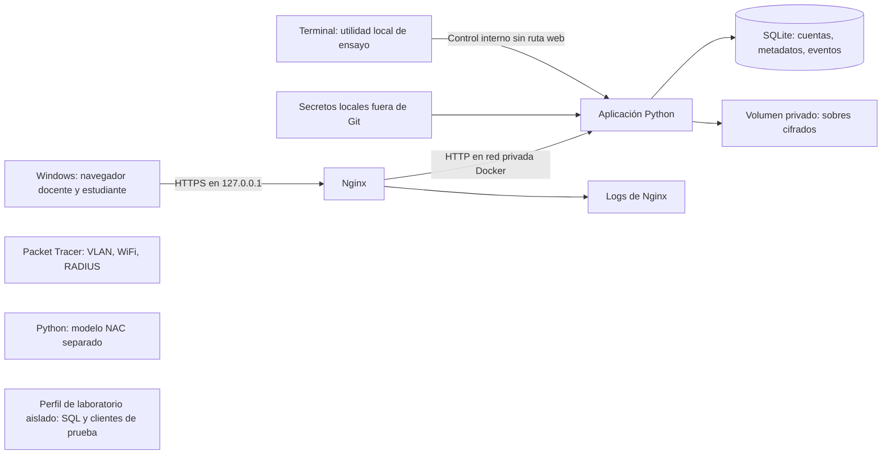

# Arquitectura prevista

**Estado: propuesta de implementación basada en Fase 3; ningún componente está construido o verificado.** F3 = `docs/planificacion/Fase_3_Diseno_El_sobre_de_las_ocho.pdf`, páginas físicas. Requisitos y respuestas HTTP: [RESUMEN_PROYECTO.md](RESUMEN_PROYECTO.md). Fuentes docentes: [MATRIZ_CLASES.md](MATRIZ_CLASES.md).

## Componentes y comunicación

La aplicación normal tiene **dos servicios Compose**, Nginx y Python; SQLite es una biblioteca dentro de Python, no otro servidor (F3 p. 2). Nginx es la única entrada publicada en `127.0.0.1`; propuesta de URL final: `https://127.0.0.1:8443`. Puerto definitivo sujeto a comprobar disponibilidad. No publicar el puerto Python ni montar su almacén en Nginx. Una red privada une proxy y aplicación. La conectividad de contenedores no implementa las VLAN de Packet Tracer.

| Pieza | Tecnología y responsabilidad | Decisión / fuente |
|---|---|---|
| Interfaz | HTML generado en servidor, CSS y JavaScript mínimo. Dos vistas según rol y bitácora docente. | Propuesta de sencillez; vistas en F3 p. 1. |
| Aplicación | Python; propuesta Flask con plantillas Jinja y servidor WSGI para contenedor, sin modo debug. | Python exigido por F3 p. 2; framework y servidor concretos por fijar en etapa 1. |
| Proxy | Nginx, HTTPS, cabeceras y cuotas. | F3 pp. 2–3; TLS/cabeceras en etapa 4 y cuota en 5. |
| Persistencia | SQLite, archivo local en volumen; consultas parametrizadas y transacciones. | SQLite en F3 pp. 2–3; detalles propuestos. |
| Criptografía | Biblioteca `cryptography` propuesta; AES-GCM, RSA-OAEP y SHA-256. | Variantes exigidas por petición y previstas por F3 p. 3. No criptografía artesanal. |
| Contraseña | Propuesta scrypt con sal aleatoria individual y parámetros guardados; evaluar soporte/coste en el portátil. | F3 p. 3 exige derivación y sal, sin imponer algoritmo. |
| MFA | TOTP local; secreto distinto de contraseñas, clave AES y clave RSA. | F3 p. 3. Autenticador local separado de la pantalla de acceso. |
| Ensayo | Utilidad de terminal ejecutada dentro del servicio, sin endpoint administrativo público. | Control local en F3 pp. 1–3. |
| Herramientas | Git, OpenSSL, Wireshark, Packet Tracer, Bandit, Trivy, Nmap/NSE y ApacheBench. | F3 pp. 2–4. No deben ser servicios permanentes del portal. |

No se fijan hoy versiones ni imágenes descargables: no se instalaron dependencias ni se consultó un catálogo externo. La etapa 1 registrará versiones y posteriormente se fijarán imágenes por versión/digest para repetir ensayos. La demostración debe funcionar sin Internet una vez preparadas imágenes, herramientas y base Trivy.

## Fronteras de confianza

El navegador y todos los datos enviados por él son no confiables. Ni botones ocultos ni una hora enviada por JavaScript autorizan la descarga. Python vuelve a comprobar identidad, rol, asignación y hora ante cada URL directa (F3 pp. 1, 3).

La sesión docente solo se considera autenticada después de contraseña y TOTP correctos. Propuesta: sesión de servidor identificada por cookie opaca; cookie `HttpOnly`, `SameSite=Lax`, `Secure` en HTTPS, expiración real, renovación al autenticar y anulación al salir. Proteger formularios de publicación con CSRF, validar tamaño/tipo del texto y usar identificadores internos para rutas de archivos. La captura no debe incluir cookies reutilizables. Son medidas propuestas para concretar seguridad y validaciones solicitadas.

Las cuentas web nunca reciben claves, rutas del almacén ni capacidad de actualizar directamente la referencia. Solo el flujo de publicación docente establece una nueva referencia para una nueva versión del parcial. La utilidad de copia alterada conserva la referencia aprobada. El propietario del portátil y un administrador del contenedor quedan fuera de la protección frente a modificación del almacenamiento: SHA-256 no impide que alguien con esos privilegios cambie archivo **y** referencia. No se afirma inviolabilidad ni auditoría inmutable.

## Ciclo del sobre

1. **Publicar:** autenticar docente con TOTP; validar texto, asignación y fecha; calcular SHA-256 sobre bytes exactos. No normalizar saltos de línea durante recuperación.
2. Generar clave AES nueva por publicación y nonce GCM aleatorio; propuesta AES-256 y nonce de 96 bits. No reutilizar el par clave/nonce. Cifrar con tag de autenticación.
3. Envolver únicamente la clave AES con RSA-OAEP; propuesta RSA de al menos 2048 bits y OAEP con SHA-256. RSA no cifra el documento completo. Guardar versión del formato, identificador de clave RSA, nonce, tag/ciphertext y clave envuelta.
4. Persistir sobre y metadatos coherentemente. SQLite y sistema de archivos no comparten transacción: propuesta archivo temporal privado, renombrado atómico y transacción de metadatos con limpieza/recuperación ante fallo. Estado incompleto nunca habilita entrega.
5. **Descargar:** respetar el orden de F3 p. 3: cuota en Nginx; sesión; rol/asignación; apertura; integridad. Desenvolver clave, verificar GCM y comparar SHA-256 de bytes recuperados con referencia protegida.
6. Solo después de todas las verificaciones devolver el documento completo y auditar 200. No usar streaming previo a validación; texto ficticio pequeño con límite de tamaño hace viable validar en memoria. Propuesta `Content-Disposition: attachment`, tipo explícito y `Cache-Control: no-store` también en errores de descarga.
7. **Ensayar:** utilidad local modifica una letra y vuelve a cifrar con material criptográfico nuevo; mantiene hash aprobado. Seleccionar esa copia produce 409 por hash, aun siendo válido el tag. Corromper tag/ciphertext es una prueba adicional distinta. Restaurar selecciona el original conservado.

Fuente del ciclo: F3 pp. 1–3. Tamaños de claves, formato, persistencia y cabeceras de descarga son propuestas. Validar claves/certificados con OpenSSL y biblioteca cuando se implemente; no guardar texto plano original en directorios web.

## Tres nociones de tiempo

| Tiempo | Uso | Quién lo cambia |
|---|---|---|
| Real | TOTP, expiración de sesiones y hora real del evento | Reloj normal del sistema; la demo no lo altera |
| Didáctico | Evaluar fecha y apertura a las 08:00 inclusive | Utilidad local controlada por el presentador |
| Evidencia | Relacionar evento con condiciones de la prueba | Registrar tiempo real y tiempo didáctico etiquetados |

F3 p. 3 exige independencia. Propuesta: proveedor de reloj inyectable solo en la política de apertura; timestamps con zona y comparación de instantes conscientes de zona. La utilidad no recibe la hora desde el navegador. Cambiar de fecha no debe permitir abrir un parcial de otra fecha por comparar solo horas.

## Datos y permisos

Modelo mínimo propuesto, no esquema implementado:

| Entidad | Campos esenciales | Restricción |
|---|---|---|
| Cuenta | ID, nombre ficticio, rol, derivado de contraseña, sal y parámetros | Dos cuentas de ensayo; sin claves en respuestas/logs |
| Sesión | ID opaco, cuenta, MFA completado, creación/expiración real | Invalida o expirada produce 401 |
| Parcial / versión | ID, docente, estudiante asignado, fecha de apertura, hash de referencia, ID de sobre y clave | Un parcial activo; hash no editable desde formularios genéricos |
| Sobre | Bytes cifrados, nonce/tag, clave AES envuelta, versión de formato | Volumen privado, fuera de estáticos |
| Evento | ID, hora real, hora didáctica si aplica, actor/anónimo, acción, decisión, motivo, ID de solicitud | Sin cuerpo, contraseña, OTP, cookie o claves |
| Estado de ensayo | Hora/offset y selector de copia | Modificable únicamente por utilidad local |

Secreto TOTP y privada RSA: archivos de secretos locales con permisos del sistema; montaje de solo lectura donde sea posible. Propuesta separar volumen de SQLite, sobres y logs; Nginx no accede a SQLite ni sobres. Las claves TLS solo se montan en Nginx. Las copias de seguridad también son privadas. No confundir «fuera de Git» con cifrado automático de un secreto en disco.

Propuestas operativas: un proceso inicial para SQLite, transacciones cortas, timeout de bloqueo, directorios escribibles mínimos, ejecución sin root donde sea viable y configuración sin privilegios Docker. Resolverlos con pruebas del equipo antes de declarar bastionado.

## Auditoría y errores

Python registra rechazos 401/403/409 y entregas 200, accesos MFA, publicación y cambios de ensayo. Nginx registra el exceso 429 y un ID correlacionable. La UI docente mostrará eventos de aplicación; una exportación combinará o adjuntará por separado el log Nginx para cubrir **todos** los intentos. No se presentará SQLite como fuente de los 429 si Python nunca recibió esas peticiones.

En 401/403 no se lee el parcial; después de apertura, hash distinto o tag inválido bloquean sin bytes del documento. Si faltan archivo/referencia, se deniega y registra un motivo específico. Código adicional propuesto en RESUMEN; errores internos no muestran traceback ni rutas. Propuesta: si no puede registrarse una decisión de entrega, no entregar y responder indisponibilidad; confirmar y probar el fallo de auditoría durante construcción.

## Red, TLS y laboratorios

El certificado local tendrá SAN para el host/IP elegido. Documentar su confianza en Windows y navegador; una excepción aceptada sin validación no equivale a una identidad TLS verificada. TLS termina en Nginx y el salto interno HTTP es privado del portátil (F3 p. 2), no cifrado extremo a extremo hasta Python. La captura HTTPS de P4 se hará del lado navegador–Nginx y sin claves de sesión.

Nginx: `server_tokens off`, `X-Frame-Options: SAMEORIGIN`, `X-Content-Type-Options: nosniff`, incluidas respuestas de error. La cabecera puede seguir diciendo `Server: nginx`; ocultar versión no corrige vulnerabilidades. Propuesta CSP ajustada a las plantillas. HSTS se explica junto a TLS; activarlo exige comprobar confianza y comportamiento local, sin afirmar que está implementado (F3 p. 4).

| Entorno | Separación y finalidad |
|---|---|
| Portal protegido | Dos servicios normales; único puerto del portal en loopback |
| HTTP de ensayo | Perfil explícito y temporal, solo marca ficticia; nunca servir la carpeta del proyecto o datos reales |
| SQL vulnerable | Perfil Compose separado, red y base propias, sin claves, cuentas ni volúmenes del portal; desactivado por defecto |
| Carga | Dos clientes Docker de IP distinta conectados a Nginx para P9; sin publicar Python ni usar la red universitaria |
| Packet Tracer | Maqueta WiFi WPA2, VLAN 10 docentes, 20 servidores, 30 alumnado, acceso/troncal y políticas entre zonas; RADIUS para administración del switch |
| NAC y ARP | Modelo Python de reglas/estado y tablas ARP ilustrativas; no filtran paquetes reales ni atacan Windows |

Las herramientas transitorias no cambian los dos servicios normales. Los perfiles de laboratorio no se levantan con el portal por defecto. Cualquier servicio de ensayo publicado en el host también se enlaza solo a `127.0.0.1`.

P9 exige como máximo 100 peticiones, concurrencia 5, cuota de 5 r/s/IP y margen 5, con código 429 explícito (F3 p. 7). Verificar las IP que ve Nginx; el NAT de Docker Desktop puede agrupar clientes del host. Usar clientes internos con IP distintas, no cabeceras `X-Forwarded-For` inventadas. Registrar latencia del cliente legítimo, CPU y distribución de códigos; no predecir un porcentaje fijo ni atribuir un DDoS real a esta prueba.

## Mapa de archivos futuros

**Todos estos nombres son propuestas, no archivos existentes.** Su función es permitir trazabilidad antes de programar.

| Ruta propuesta | Responsabilidad |
|---|---|
| `compose.yaml`, `Dockerfile`, `requirements.txt` | Servicios normales, empaquetado y dependencias fijadas |
| `infra/nginx/default.conf` | Proxy, TLS, cabeceras, logs y cuota |
| `app/__init__.py`, `app/config.py` | Creación de aplicación y configuración |
| `app/auth.py`, `app/policy.py`, `app/clock.py` | Identidad/TOTP, permisos/descarga y reloj didáctico |
| `app/crypto.py`, `app/storage.py`, `app/db.py`, `app/audit.py` | Sobre, persistencia, consultas y eventos |
| `app/templates/`, `app/static/styles.css` | Vistas y diseño accesible |
| `scripts/demo.py` | Hora, copia alterada, restauración; solo terminal |
| `scripts/security_checks.ps1` | Flujo local de controles y bloqueo de promoción |
| `labs/compose.labs.yaml`, `labs/sql/`, `labs/http/` | Entornos de ensayo aislados |
| `labs/nac/model.py`, `labs/network/topologia.pkt`, `labs/network/arp.md` | Simulaciones separadas |
| `tests/test_auth.py`, `tests/test_policy.py`, `tests/test_crypto.py`, `tests/test_audit.py` | Pruebas automáticas de reglas críticas |
| `tests/test_nac.py`, `tests/test_labs.py`, `tests/test_demo.py` | Reglas simuladas, aislamiento y restauración |
| `docs/GUIA_WINDOWS.md`, `docs/evidencias/` | Guía futura y fichas saneadas; artefactos privados ignorados |

La UI propuesta usa el sobre sellado como identidad visual, jerarquía clara, tipografía legible, foco visible y estados textuales «cerrado», «disponible» o «entrega bloqueada». Los textos reflejan respuestas reales del servidor; un indicador verde no certifica cifrado ni integridad. Contrastar escritorio/móvil, teclado y errores en etapas 1–3 y 6.

## Decisiones pendientes acotadas

En etapa 1: framework/WSGI, versiones, puerto, recursos y diseño inicial. En etapa 2: política de TOTP, caducidad y protección de secretos. En etapa 3: formato del sobre, atomicidad y errores no fijados por F3. En etapa 4: certificado confiable y soporte concreto de Packet Tracer. En etapa 5: CVE corregible, umbrales de Bandit y versión/base Trivy. Son decisiones de ejecución; no autorizan sustituir tecnologías centrales ni iniciar otra etapa.
