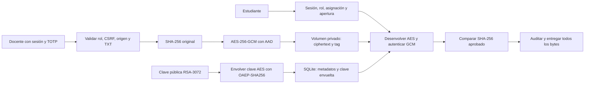

# El sobre cifrado — etapa 3

Implementación local de carga, protección, verificación y entrega de texto ficticio. Se conserva FastAPI/Uvicorn, Nginx, SQLite, el volumen `identidad`, las cuentas existentes, TOTP y el reloj de evaluaciones. F3 = `docs/planificacion/Fase_3_Diseno_El_sobre_de_las_ocho.pdf`, pp. 1–3 y 5–7. Los resultados observados se registran en [evidencia 3](evidencias/etapa-03.md). Etapas 4–6 pendientes.

## Flujo y responsabilidades



| Archivo | Responsabilidad real |
|---|---|
| `app/crypto.py` | AESGCM, RSA-OAEP, AAD de formato/evaluación/versión, SHA-256 |
| `app/storage.py` | Validar TXT, archivos privados, clave persistente, versiones, recuperación, limpieza y copias locales |
| `app/documents.py` | POST docente, GET estudiante, revalidación de política y auditoría antes de responder |
| `app/policy.py` | Política existente, sin duplicar roles/asignación/apertura |
| `app/evaluations.py` | Disponibilidad y paneles integrados con el sobre |
| `app/db.py` | Tabla aditiva `documentos`; conserva el resto del esquema |
| `app/demo.py` | Nuevas acciones `sobre`; comandos 2B conservados |
| Plantillas/CSS/`availability.js` | Formularios nativos, estado y enlace que reflejan el backend |

## Criptografía y formato

Biblioteca de ejecución: **cryptography 50.0.2**, fijada en requisitos. Se verificaron los metadatos oficiales de PyPI al incorporarla. Las operaciones usan las API de [AESGCM](https://cryptography.io/en/stable/hazmat/primitives/aead/#cryptography.hazmat.primitives.ciphers.aead.AESGCM) y [RSA-OAEP](https://cryptography.io/en/stable/hazmat/primitives/asymmetric/rsa/#encryption), sin primitivas propias.

Cada cifrado genera una clave AES de 32 bytes y nonce de 12 bytes mediante fuentes criptográficas de la biblioteca/sistema. AESGCM devuelve ciphertext con tag de 16 bytes, sin truncar. No se reutiliza material al publicar o preparar la copia alterada. Restaurar selecciona un cifrado existente: no vuelve a cifrar con su par clave/nonce.

RSA de 3072 bits y exponente 65537 envuelve solo la clave AES mediante OAEP con SHA-256 y MGF1-SHA256. La pública se deriva de la privada; no se necesita otra copia persistente de la pública. El archivo grande nunca se pasa a RSA. El AAD es JSON canónico de `sobre-v1`, ID de evaluación y versión aleatoria de 128 bits. Intercambiar evaluación o versión invalida GCM.

SQLite conserva por evaluación: versión, nombre seguro, tamaño, SHA-256 original, fecha de publicación, cuenta creadora y dos descriptores JSON (`original`/`activo`). Cada descriptor contiene ID aleatorio del cifrado, nonce y clave AES envuelta. Representarlos en hexadecimal facilita persistencia; hexadecimal no es cifrado. El contenido y las claves AES en claro no se escriben a disco.

## Persistencia y límites

- `/data/portal.sqlite3`: metadatos, referencias y auditoría en el volumen `identidad`.
- `/data/sobres/<id-aleatorio>.gcm`: solo ciphertext/tag, sin rutas elegidas por el cliente.
- `/data/secrets/sobre-rsa.pem`: privada PKCS8, 0600. Directorios 0700. La misma carpeta contiene el TOTP preexistente, que no se modifica.
- Nginx no monta `/data`; `/static` solo sirve recursos de la aplicación. Git ignora PEM, SQLite, `.gcm` y datos; el contexto Docker permite solo código/requisitos/pruebas.

La primera publicación crea la privada bajo bloqueo SQLite. Las siguientes la reutilizan. Si desaparece y hay documentos, se bloquea; no se genera otra clave para ocultar la pérdida. Reiniciar/recrear contenedores conserva el volumen. No ejecutar `down -v` contra el portal. Respaldar privadamente todo `/data` de forma consistente: base, clave, sobres y TOTP. Perder la clave no se resuelve con restaurar una copia cifrada.

La privada no está cifrada con una contraseña en disco: permisos Linux, proceso sin root, volumen privado y acceso local a Docker son la frontera del laboratorio. Un administrador del equipo puede extraer/modificar datos y claves. Producción requeriría KMS/HSM o gestor de secretos, rotación/identificación de claves, respaldos y controles operativos independientes. No se afirma aislamiento frente al propietario de Docker.

Se acepta solo `.txt` UTF-8, hasta **512 KiB**, no vacío y sin controles binarios salvo tabulación/saltos de línea. MIME no decide aceptación. El parser normaliza nombres Windows a basename; después se rechazan rutas restantes y se genera un nombre ASCII seguro para la descarga. Se conservan exactamente los bytes originales, incluidos BOM o saltos de línea válidos. PDF, DOCX, ZIP y ejecutables quedan fuera del requisito de texto de F3.

El cuerpo multipart completo se acota a 512 KiB + 16 KiB, un archivo y dos campos. Nginx conserva su límite 1 MiB. Máximo 32 evaluaciones con documento y 32 MiB de cifrados en el laboratorio. Todo se verifica en memoria antes de responder; no se transmite texto parcialmente descifrado. No hay antivirus: el límite a TXT, attachment y nosniff reduce exposición, pero no certifica que las instrucciones del texto sean benignas.

Una escritura usa temporal 0600, fsync, rename atómico y fsync del directorio antes de referenciarla en SQLite. No existe transacción distribuida entre SQLite y archivos. El bloqueo SQLite serializa publicación, selección de copias y lectura íntegra. Si cae antes de commit puede quedar un cifrado huérfano, nunca una referencia a texto parcial aprobado. La limpieza elimina solo IDs no referenciados bajo bloqueo. El almacenamiento total limita huérfanos; no se promete recuperación automática de todo fallo físico del disco. Un fallo después de commit puede requerir reconsultar el panel para confirmar la publicación.

## Autorización y respuestas

POST `/evaluaciones/{id}/documento`: docente completo con MFA, validación de sesión/origen/CSRF y archivo. GET en la misma ruta: estudiante vigente, rol, asignación, apertura y documento íntegro. No se concede al docente la descarga estudiantil. El servicio reutiliza `consultar_disponibilidad` y `decidir_disponibilidad`; revalida bajo el bloqueo de lectura/versión. La disponibilidad JSON también verifica el sobre cuando el horario permite acceder. Antes de horario no descifra.

| Caso | Respuesta |
|---|---|
| Sin sesión / docente sin MFA | 401 |
| Rol, asignación u horario incorrectos | 403, sin bytes del documento |
| CSRF u origen inválidos | 403 |
| TXT inválido / cuerpo excesivo | 400 / 413 |
| Publicación correcta | 303 al panel; nueva versión y nueva referencia autorizada |
| Estudiante autorizado pero documento no publicado | Descarga 404; disponibilidad 200 con `descarga_habilitada: false` |
| GCM/SHA/clave/archivo/metadatos inválidos o ausentes | 409 sin documento; motivo interno específico |
| Configuración horaria o persistencia operativa no disponibles | 503 |
| Documento autorizado e íntegro | 200, bytes exactos, attachment, nosniff, no-store/private |

El orden de 401/403/409/200 conserva F3 p. 3. 400/404/413/503 concretan casos no fijados por F3. La ruta histórica `/descargar` permanece inexistente: la entrega usa el ID de evaluación y su política.

SHA-256 se calcula sobre el original en publicación y sobre lo recuperado antes de cada entrega, con comparación constante. La descarga y la CLI de alteración/restauración no actualizan la referencia. Una publicación docente legítima sí establece otra versión y su referencia. El hash no es firma digital ni protección contra quien pueda reemplazar simultáneamente archivo, metadatos y referencia. GCM autentica el cifrado; SHA comprueba que el texto autenticado corresponde al original aprobado.

Los errores HTTP no revelan claves, rutas internas, traceback ni contenido. Auditoría registra cuenta/operación/recurso/motivo, instante real y referencia didáctica separados; si falla el registro de entrega, no se envía el documento. El docente consulta los últimos 12 eventos de documentos. La CLI permite más detalle controlado, sin claves ni contenido. La bitácora no es inmutable.

## Demostración reproducible en CMD

Docker Desktop Linux activo; cuentas 2A ya inicializadas. No volver a inicializarlas. Desde la raíz:

```bat
cd /d C:\Users\juanv\Proyectos\el-sobre-de-las-ocho
docker compose up -d --build --wait --wait-timeout 120
start http://127.0.0.1:8080/acceso
docker compose exec app python -m app.demo preparar --fecha 2026-11-09
```

El comando anterior es el de 2B: prepara metadatos/asignación/reloj, no publica ni borra el documento. En ventana docente: contraseña y TOTP, seleccionar `.txt` dentro de la evaluación y **Publicar documento protegido**. El control de archivo muestra su nombre. La confirmación y fecha quedan en el panel. Si hay varias evaluaciones, cada formulario identifica la evaluación correspondiente; no se crean duplicados.

Como alternativa reproducible sin seleccionar un archivo externo, publicar el texto ficticio incorporado mediante la utilidad local:

```bat
docker compose exec app python -m app.demo sobre preparar
docker compose exec app python -m app.demo sobre estado
```

`sobre preparar` **reemplaza el documento de evaluacion-001** con la muestra; usar solo si se desea esa sustitución. No cambia usuarios, TOTP, asignación ni reloj. `estado` muestra algoritmos, tamaño, huella original y recuperada, autenticación GCM e integridad; no muestra claves ni plaintext. Cifrar y recuperar criptográficamente, comprobar que el fichero almacenado no contiene el original y comparar bytes es evidencia más fuerte que «parece ilegible».

Abrir otra ventana privada, iniciar sesión estudiante y pulsar **Comprobar acceso** tras cada cambio:

```bat
docker compose exec app python -m app.demo reloj fijar 2026-11-09T07:59:59
docker compose exec app python -m app.demo reloj fijar 2026-11-09T08:00:00
```

Primero bloqueado sin enlace; después acceso autorizado y **Descargar documento**. La ruta también revalida las condiciones si se escribe directamente en el navegador: `http://127.0.0.1:8080/evaluaciones/evaluacion-001/documento`.

```bat
docker compose exec app python -m app.demo asignacion retirar
docker compose exec app python -m app.demo asignacion asignar
```

Sin asignación la descarga continúa en 403 aun a las ocho. Reasignar restituye el permiso. No se cambian comandos anteriores.

Caso A, cifrado dañado, con apertura cumplida:

```bat
docker compose exec app python -m app.demo sobre alterar-gcm
docker compose exec app python -m app.demo sobre estado
docker compose exec app python -m app.demo sobre auditoria
```

Comprobar acceso/descarga → 409. GCM no autentica; motivo de auditoría `autenticacion_gcm_fallida`. No se emite documento. Restaurar:

```bat
docker compose exec app python -m app.demo sobre restaurar
```

Caso B, otra letra correctamente cifrada:

```bat
docker compose exec app python -m app.demo sobre alterar-hash
docker compose exec app python -m app.demo sobre estado
```

GCM correcto, SHA recuperado distinto del original. Comprobar acceso/descarga → 409; motivo `discrepancia_sha256`. La copia usa clave AES/nonce nuevos y AAD de la misma versión; la referencia queda intacta. Restaurar y repetir descarga → 200 idéntico:

```bat
docker compose exec app python -m app.demo sobre restaurar
docker compose exec app python -m app.demo sobre auditoria
docker compose exec app python -m app.demo auditoria --limite 20
docker compose exec app python -m app.demo preparar --fecha 2026-11-09
```

El último comando vuelve a cerrar el reloj/asignación, no elimina el original publicado. Todas las acciones `sobre` aceptan `--evaluacion ID` para un recurso existente. No hay endpoint de alteración/restauración ni acceso web al laboratorio. Los permisos de Docker autorizan esta herramienta local; no es una capacidad del rol docente.

## Pruebas y relación docente

`tests/test_crypto.py` prueba primitivas reales, independencia de claves, AAD y rechazo de ciphertext/tag/privada ajena. `tests/test_documents.py` cubre publicación, controles HTTP, bytes, horarios, asignación, persistencia, faltantes, auditoría y restauración. La suite conserva los casos de 2A/2B. `scripts/verificar_identidad.cjs` añade publicación/descarga reales por Nginx, reinicio con volumen efímero propio, ambas alteraciones, restauración y capturas/axe de escritorio/móvil. El proyecto de prueba se destruye con su propio volumen; no borra `identidad`.

```bat
docker build --target test -t el-sobre-de-las-ocho-tests:etapa3 .
docker run --rm --network none --read-only --tmpfs /tmp el-sobre-de-las-ocho-tests:etapa3
python scripts\verificar_etapa1.py
node scripts\verificar_identidad.cjs
```

Fuentes comprobadas: C1, `Semana 1 comunicación y seguridad informatica (martes 1ro de septiembre) CORRECTA.pdf`, p. 7 (simetría/asimetría/hashes), pp. 9–11 (AES-CBC/OpenSSL), pp. 12–13 (edición y hash MD5). GCM/OAEP/SHA-256 son las decisiones del proyecto, no algoritmos atribuidos al taller. C4 pp. 4–7 y 15 relaciona AAA, MFA, RBAC/ABAC y mínimo privilegio según la matriz ya existente. F3 pp. 1–3 y 6 exige publicación, límite inclusivo, original idéntico y copia distinta con huella conservada. No se acreditan P4–P10 ni nuevas prácticas de red con estos resultados.

HTTP local continúa sin cifrado de transporte; HTTPS, Wireshark, Packet Tracer y NAC corresponden a etapa 4. Cifrado en reposo no sustituye TLS. No se incorporan SQLi, carga/DoS o DevSecOps completos, ni PDF/diapositivas finales.
